# 밤하늘의 10만 개 빛을 분류하는 두 가지 인공지능 이야기: 정통 딥러닝(DL)부터 스스로 뇌 구조를 진화시키는 신경망(EDL)까지

> **"멀리서 반짝이는 저 빛은 별(Star)일까, 거대한 은하(Galaxy)일까, 아니면 초기 우주의 초대질량 블랙홀이 뿜어내는 퀘이사(Quasar)일까?"**
>
> 본 리서치 블로그 포스트에서는 슬론 디지털 전천 탐사(**SDSS-17**)가 관측한 **100,000개의 천체 데이터**를 바탕으로, 천체를 97.4%~97.9%의 정확도로 분류해 내는 두 가지 인공지능 패러다임의 여정을 소개합니다.
> 1. **정통 딥러닝과 앙상블 (Deep Learning, `DL/`)**: 천문학적 도메인 지식(색지수와 적색편이)을 바탕으로 정교하게 다듬은 역전파 신경망과 트리 앙상블의 여정
> 2. **스스로 뇌 구조와 가중치를 진화시키는 진화 신경망 (Evolutionary Deep Learning, `EDL/`)**: 생물학적 진화 원리(돌연변이·교배·적자생존)를 통해 **인간이 설계하지 않은 새로운 신경망 구조(Topology)를 스스로 발명**하며 기존 딥러닝 단일 모델을 뛰어넘기까지의 탐구 기록
>
> > [!NOTE]
> > **안내 (제3의 패러다임 GravNet 연계)**: 본 블로그는 프로젝트의 1단계 연구 성과인 **역전파 딥러닝(`DL/`) vs. 위상·가중치 진화 신경망(`EDL/`)**의 2대 패러다임 비교를 다룹니다. 이후 제1원리 천체역학 기반으로 새롭게 개발된 제3의 무역전파 모델 **시공간 중력장 궤도 신경망(`GravNet/`)**에 대한 학술 논문 및 상세 보고서는 아래 문서를 참조하십시오:
> > - **IEEE 저널 논문**: [`docs/gravnet_ieee.pdf`](./gravnet_ieee.pdf) (6쪽 IEEEtran 저널 규격 논문)
> > - **상세 기술 보고서**: [`docs/gravnet_research_report.pdf`](./gravnet_research_report.pdf) (12쪽 기술 보고서)
> > - **차세대 9대 신개념 모델 설계서**: [`docs/proposed_novel_models.md`](./proposed_novel_models.md)

---

## 목차 (Table of Contents)

1. [프롤로그: 밤하늘의 점 10만 개를 구분하는 법](#1-프롤로그-밤하늘의-점-10만-개를-구분하는-법)
2. [데이터 탐험: "이상치(Outlier)인 줄 알았는데 보물이었다!"](#2-데이터-탐험-이상치outlier인-줄-알았는데-보물이었다)
3. [첫 번째 길 — 정통 딥러닝(DL): 작지만 강한 신경망과 물리적 한계](#3-첫-번째-길--정통-딥러닝dl-작지만-강한-신경망과-물리적-한계)
4. [두 번째 길 — 진화 신경망(EDL): 미분 대신 '생물학적 진화'로 학습하다](#4-두-번째-길--진화-신경망edl-미분-대신-생물학적-진화로-학습하다)
5. [시행착오와 돌파구: 왜 초기 진화 신경망은 딥러닝보다 낮았을까?](#5-시행착오와-돌파구-왜-초기-진화-신경망은-딥러닝보다-낮았을까)
6. [궁극의 진화 — 뇌 구조(Topology) 자체를 스스로 진화시키다 (TWEANN)](#6-궁극의-진화--뇌-구조topology-자체를-스스로-진화시키다-tweann)
7. [속도 대결: 학습 시간 & 추론 속도 벤치마크](#7-속도-대결-학습-시간--추론-속도-벤치마크)
8. [에필로그: 이번 연구가 남긴 시사점](#8-에필로그-이번-연구가-남긴-시사점)

---

## 1. 프롤로그: 밤하늘의 점 10만 개를 구분하는 법

망원경으로 밤하늘을 찍으면 수많은 빛의 점들이 찍힙니다. 맨눈이나 단순한 흑백 사진만으로는 우리 은하 안에 있는 가까운 **별(STAR)**인지, 수억 개의 별이 모인 외부 **은하(GALAXY)**인지, 혹은 수십억 광년 너머에서 은하 전체보다 밝게 빛나는 활동성 은하핵 **퀘이사(QSO, Quasar)**인지 구분하기 어렵습니다.

우리가 다룬 **SDSS-17 (Sloan Digital Sky Survey DR17)** 데이터셋에는 총 **100,000개**의 천체 관측 기록이 담겨 있습니다.

| 천체 종류 (Class) | 데이터 개수 | 비중 | 천문학적 특징 |
|---|---|---|---|
| **은하 (GALAXY)** | 59,445개 | **59.4%** | 수억~수조 개의 별과 성운이 모인 거대한 집단 |
| **별 (STAR)** | 21,594개 | **21.6%** | 우리 은하 내부에서 스스로 빛을 내는 항성 (지구와 매우 가까움) |
| **퀘이사 (QSO)** | 18,961개 | **19.0%** | 초기 우주의 초대질량 블랙홀 주변 강착원반에서 뿜어져 나오는 극도로 밝은 빛 |

천문학자들은 이 천체들을 구분하기 위해 크게 두 가지 물리량을 측정합니다:

1. **5가지 색상 필터를 통과한 밝기 (측광 등급, $u, g, r, i, z$)**:
   - 자외선($u$), 초록빛($g$), 붉은빛($r$), 근적외선($i, z$) 5개 파장 대역에서 천체가 얼마나 밝게 보이는지를 측정합니다.
2. **적색편이 (Redshift, $z_{\text{spec}}$)**:
   - 우주는 팽창하고 있기 때문에, 지구에서 멀리 떨어진 천체일수록 그 천체가 방출한 빛의 파장이 길어지며 붉은색 쪽으로 치우칩니다(도플러 효과와 유사한 우주론적 적색편이).
   - 즉, **적색편이($\text{redshift}$)는 천체가 지구로부터 얼마나 아득히 먼 우주에 있는지를 알려주는 '우주 거리계'**입니다.

---

## 2. 데이터 탐험: "이상치(Outlier)인 줄 알았는데 보물이었다!"

데이터 분석의 첫걸음은 결측치와 이상치(Outlier)를 살피는 것입니다. 10만 개 데이터를 전수 조사한 결과, 딱 1개의 행(79,543번째 행)에 센서 오류 값(`-9999`)이 들어 있어 이를 정제하고 **99,999개**의 유효 천체 데이터를 확보했습니다.

그런데 통계적 이상치 탐지 기법(1.5×IQR 박스플롯)을 적용하자 흥미로운 현상이 나타났습니다. **`redshift`(적색편이) 변수에서 무려 8,990개(약 9%)의 데이터가 '통계적 이상치'로 분류된 것**입니다!

> **초보 데이터 분석가가 빠지기 쉬운 함정**:
> *"박스플롯 바깥에 찍힌 8,990개의 이상치를 노이즈로 보고 지워버리면 어떻게 될까?"*

저희는 이 이상치들을 무작정 지우는 대신, 각 이상치가 어떤 천체에 속하는지 교차 분석을 수행했습니다.

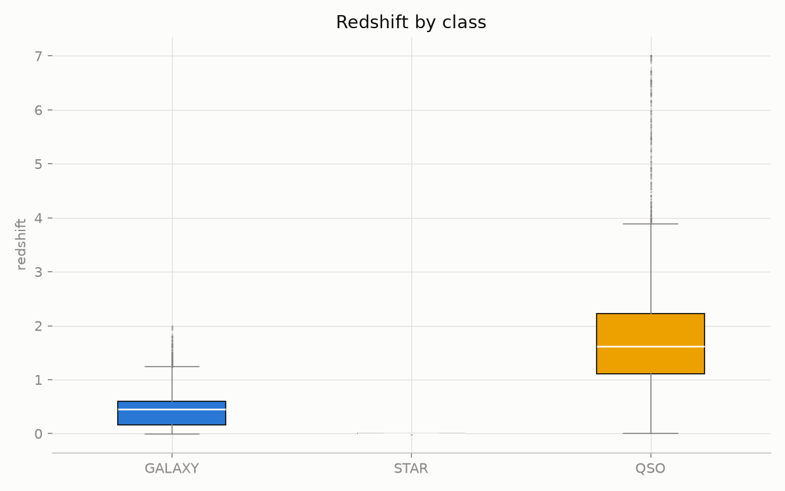

결과는 놀라웠습니다:
- `redshift` 이상치로 지목된 **8,990개 중 99.6%(8,956개)가 바로 퀘이사(QSO)**였습니다!
- 우리 은하 안의 **별(STAR)**은 거리가 가까워 $\text{redshift} \approx 0$에 모여 있고, 일반 **은하(GALAXY)**는 중앙값 $0.42$ 부근에 분포하는 반면, 초기 우주 끝에 존재하는 **퀘이사(QSO)**는 적색편이가 $1.6$에서 최대 $7.0$까지 길게 뻗어 있었던 것입니다.
- 즉, 통계적으로는 '극단값(Outlier)'처럼 보였지만 천체물리학적으로는 **"이 천체는 100% 퀘이사다!"라고 알려주는 가장 결정적인 보물 신호**였습니다. 대신 왜도가 심한 분포를 신경망이 잘 소화할 수 있도록 $\log(1 + \text{redshift})$ 변환을 적용했습니다.

### 천체의 '표면 온도'를 알려주는 마법의 변수: 색지수 (Color Index)

여기에 더해 천문학 도메인 지식을 하나 더 추가했습니다. 인접한 두 필터의 등급 차이인 **색지수(Color Index)** 4개($u-g, g-r, r-i, i-z$)를 파생 변수로 만든 것입니다.

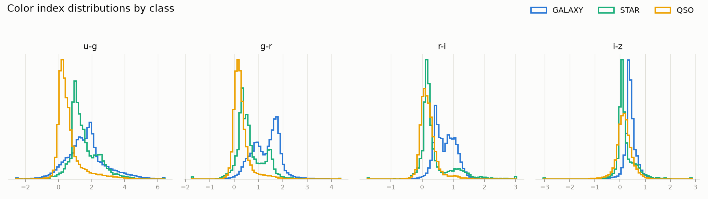

위 그래프에서 볼 수 있듯, 5개의 원본 밝기($u,g,r,i,z$)만 볼 때보다 **필터 간의 차이(색지수)**를 계산했을 때 세 천체의 개성이 선명하게 갈라집니다:
- **퀘이사(QSO, 노란색)**: 고온의 블랙홀 강착원반에서 나오는 자외선이 강해 $u-g \approx 0.39$로 가장 푸릅니다.
- **은하(GALAXY, 파란색)**: 나이 든 적색 거성들의 빛이 섞여 $u-g \approx 1.64$, $g-r \approx 1.40$으로 가장 붉습니다.
- **별(STAR, 청록색)**: 두 천체의 중간 대역에 날카롭게 분포합니다.

이렇게 탄생한 **10개의 정예 특성(측광 5개 + 적색편이 1개 + 색지수 4개)**이 두 인공지능(DL과 EDL)의 공통 연료가 되었습니다.

---

## 3. 첫 번째 길 — 정통 딥러닝(DL): 작지만 강한 신경망과 물리적 한계

첫 번째 트랙([`DL/`](../DL/))에서는 현대 인공지능의 표준인 **역전파(Backpropagation)와 경사하강법(Adam Optimizer)**을 사용하는 다층 퍼셉트론(MLP)을 설계했습니다.

### 3.1 "신경망을 무조건 깊게 쌓으면 더 똑똑해질까?"

많은 분들이 딥러닝이라고 하면 수십~수백 층의 거대한 신경망을 떠올립니다. 과연 10개의 천체 물리량을 분류하는 문제에서도 층이 깊을수록 좋을까요? 직접 0층(로지스틱 회귀)부터 3층 신경망까지 비교 실험을 수행했습니다.

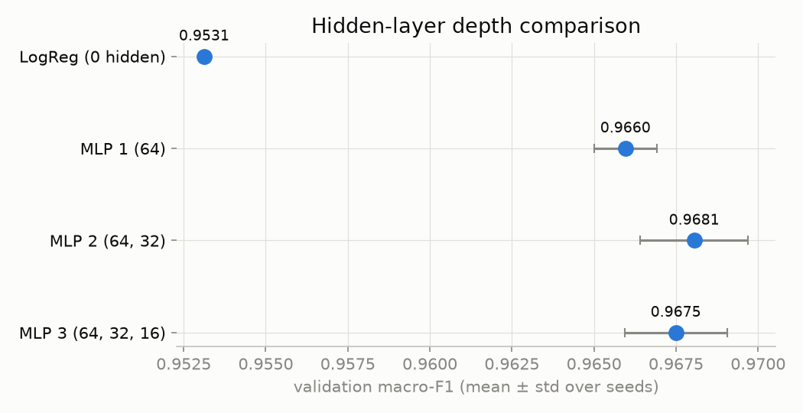

- **0층 (선형 모델, `Macro-F1 0.9531`) $\rightarrow$ 1층 (`0.9660`)**: 비선형 활성화 함수(ReLU)가 들어가자마자 성능이 **+1.3%p** 급증합니다.
- **1층 (`0.9660`) $\rightarrow$ 2층 `(64, 32)` (`0.9681`)**: 한 층을 더 쌓자 소폭 상승하며 최고점에 도달합니다.
- **2층 $\rightarrow$ 3층 `(64, 32, 16)` (`0.9675`)**: 층을 3개로 늘리자 오히려 과적합이 시작되며 성능이 내려갑니다.

이를 통해 **"정형화된 10차원 천체 물리 데이터에서는 2층 구조 `(64, 32)`가 가장 이상적인 베이스라인"**임을 실험적으로 확인했고, 여기에 앞서 만든 **색지수 특성 4개**를 결합해 PyTorch로 정밀 학습시킨 결과 테스트 세트(20,000건)에서 **정확도 `97.37%` (Macro-F1 `0.9700`)**를 달성했습니다.

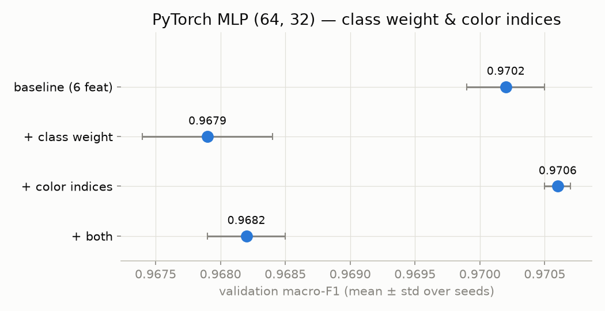

### 3.2 "왜 정확도 99%는 도달하지 못할까?" — 오분류 522건의 천체물리학적 해부

20,000개의 테스트 천체 중 단일 딥러닝 모델이 틀린 **522개(2.6%)**는 대체 어떤 천체들일까요? 오류의 원인을 밝히기 위해 오분류된 천체들의 적색편이와 밝기 분포를 정밀 해부했습니다.

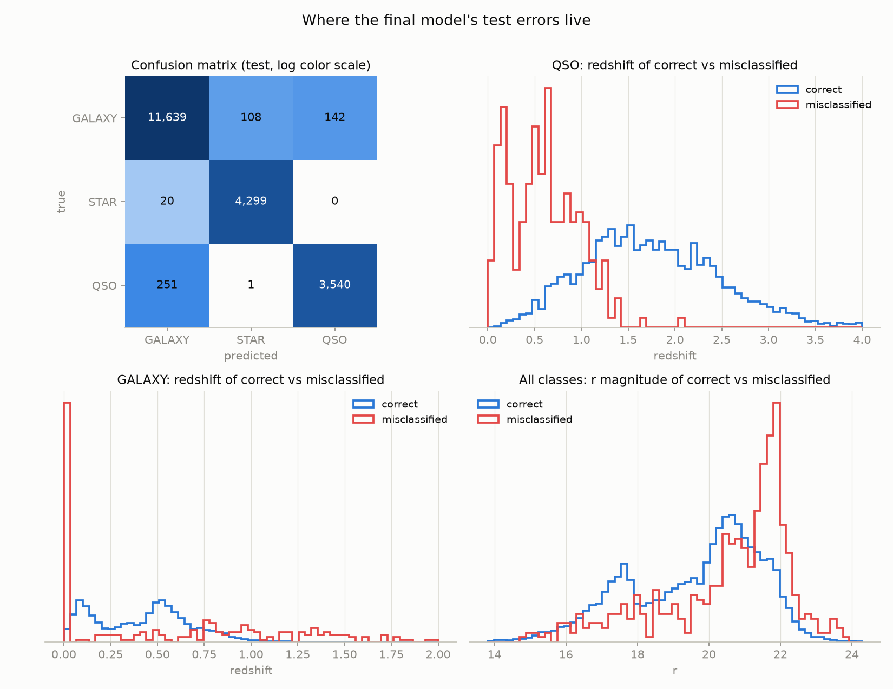

분석 결과, 인공지능이 헷갈린 이유에는 명확한 **물리학적 원인**이 있었습니다:
1. **전체 오분류의 75.3%가 `은하(GALAXY) ↔ 퀘이사(QSO)` 사이의 혼동**이었습니다. (별 `STAR`는 99.5% 이상 완벽히 구분합니다.)
2. 특히 **퀘이사인데 은하로 잘못 분류된 천체들의 적색편이 중앙값은 `0.588`**로, 정상 분류된 퀘이사(`1.711`)보다 지구에 훨씬 가까운 **'저적색편이 퀘이사(Low-redshift QSO)'**였습니다.
   - 퀘이사는 사실 은하 중심부에 있는 거대한 블랙홀입니다. 너무 멀리 있는 퀘이사는 중심부 불빛만 보여 쉽게 구분되지만, **비교적 가까운 퀘이사는 블랙홀을 둘러싼 모은하(Host Galaxy)의 별빛이 함께 섞여 관측**되기 때문에 측광 스펙트럼상 은하와 물리적으로 겹치게 됩니다.
3. 또한 오류의 절반 이상이 망원경 검출 한계에 가까운 **매우 어두운 천체($r > 21.05$ 등급)**에서 발생했습니다.

즉, 남은 2% 남짓한 오류는 모델이 부족해서가 아니라 **측광 데이터 자체가 물리적으로 겹치는 경계 영역**에 존재했습니다. 이 경계선에서 최대한의 성능을 짜내기 위해 딥러닝 신경망(`MLP × 3`)과 정형 데이터의 강자인 그래디언트 부스팅 트리(`XGBoost` + `HistGradientBoosting`)를 결합한 **이종 소프트 보팅 앙상블(Heterogeneous Soft-Voting Ensemble)**을 구축했고, 최종적으로 **테스트 정확도 `97.88%` (Macro-F1 `0.9755`)**에 도달했습니다.

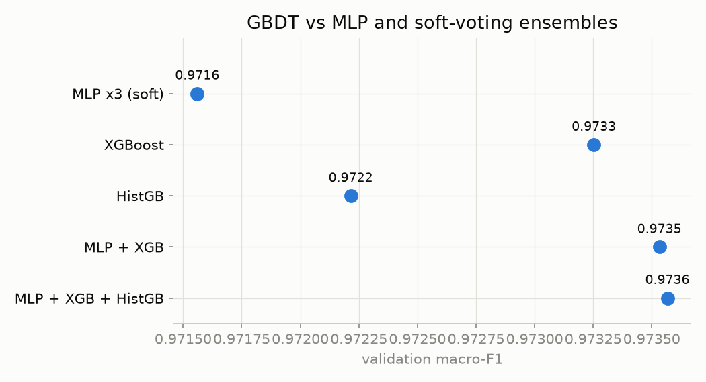

---

## 4. 두 번째 길 — 진화 신경망(EDL): 미분 대신 '생물학적 진화'로 학습하다

여기서 우리는 근본적이고 도전적인 질문을 던졌습니다.

> **"미분(역전파)이라는 수학 공식 없이, 다윈의 생물학적 진화 원리(돌연변이·교배·자연선택)만으로 신경망을 학습시킬 수 없을까? 더 나아가, 신경망의 뇌 구조 자체도 스스로 진화하게 만들 수는 없을까?"**

이 질문에서 출발한 것이 바로 두 번째 연구 트랙인 **[`EDL/` (Evolutionary Deep Learning)](../EDL/)**입니다.

### 일반인을 위한 비유: '역전파 딥러닝' vs. '진화 신경망'

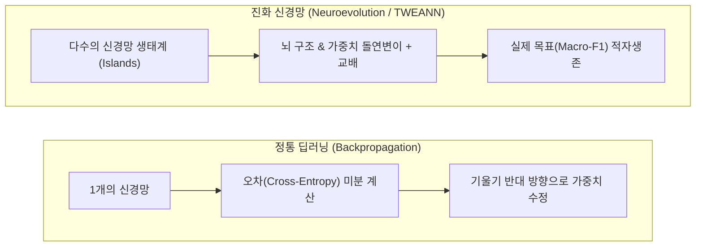

- **정통 딥러닝 (모범생 스타일)**:
  - 문제집을 풀고 채점한 뒤, 틀린 문제를 **미분(Derivative)**이라는 수학 공식에 대입해 "어느 뉴런의 가중치를 몇 퍼센트 고쳐야 하는지" 역방향으로 계산(역전파)합니다.
  - 단, 미분이 가능해야 하므로 우리가 진짜 원하는 성적표인 **Macro-F1 점수**(계단 함수라 미분 불가능)를 직접 최적화하지 못하고, 미분이 가능한 대리 시험지(**교차 엔트로피 손실, Cross-Entropy Loss**)를 대신 풀어야 합니다.
- **진화 신경망 (생태계 스타일)**:
  - 여러 개의 신경망 개체(Population)를 동시에 풀어놓습니다.
  - 조금씩 다른 가중치나 뇌 구조를 가진 자식들을 낳고(**돌연변이와 교배**), 미분 가능 여부와 상관없이 **실제 목표 성적표인 `Macro-F1 점수`가 가장 높은 개체만 살아남아 다음 세대의 부모가 됩니다(적자생존)**.

---

## 5. 시행착오와 돌파구: 왜 초기 진화 신경망은 딥러닝보다 낮았을까?

### 5.1 첫 번째 실험: 순수 무미분 진화 전략 (Pure ES) — `96.48%`의 벽

가장 먼저, 역전파를 전혀 쓰지 않는 **순수 자연 진화 전략(Natural Evolution Strategy, OpenAI-ES)**으로 `(32, 16)` 구조의 신경망 가중치 931개를 진화시켰습니다.
- 놀랍게도 미분 계산을 단 한 번도 하지 않고 **단 `13.55초`(190세대)** 만에 **테스트 정확도 `96.48%` (Macro-F1 `0.9599`)**까지 올라갔습니다!
- 하지만 정통 딥러닝 단일 MLP(`97.37%`)와 비교하면 **약 `0.89%p`의 격차**가 존재했습니다. 세대 수를 300세대로 늘려도 `96.48%` 부근에서 수렴이 멈췄습니다.

### 5.2 원인 진단: 왜 순수 무작위 진화는 96.5%에서 멈췄을까?

수학적·실험적 분석을 통해 세 가지 근본 원인을 밝혀냈습니다:

1. **고차원 공간에서의 '눈 감고 다이얼 맞추기' 한계 ($\mathcal{O}(D/P)$ 분산 병목)**:
   - 신경망의 가중치 개수가 $D = 1,000 \sim 3,000$개일 때, 한 세대에 $P = 80$개의 개체로 무작위 방향을 탐색하면 세대당 고작 40개의 방향만 더듬어 볼 수 있습니다.
   - 수학적으로 무작위 섭동 기울기 추정치의 분산은 차원 $D$에 비례해 커집니다($\text{Var} \propto D/P$). 큰 줄기(별 vs 은하)는 10초 만에 빠르게 맞추지만, **저적색편이 퀘이사와 은하가 아슬아슬하게 겹치는 미세한 비선형 경계선**을 깎아내는 데에는 무작위 더듬기만으로는 정밀도가 부족했던 것입니다.
2. **계단 모양 점수판(이산 Macro-F1)의 사각지대**:
   - `Macro-F1`은 최종 예측 클래스(`argmax`)가 바뀌어야만 점수가 변합니다. 가중치를 살짝 바꿨을 때 예측 확률이 $0.41 \rightarrow 0.48$로 좋은 방향으로 개선되었더라도, $0.50$을 넘지 못하면 점수 변화가 $0$으로 찍혀 진화 신호가 사라집니다.
3. **결정 경계(Decision Boundary) 미세 조정의 부재**:
   - 은하(59.4%)와 퀘이사(19.0%)의 비율이 3배 이상 차이 나기 때문에, 마지막 출력층의 클래스별 문턱값(Threshold)을 정교하게 조율하는 유전자가 따로 필요했습니다.

### 5.3 1차 돌파: 다중 섬 라마르크 진화 + 결정 경계 유전자 진화 (`96.48%` $\rightarrow$ `97.38%`)

이 세 가지 약점을 해결하기 위해 진화 알고리즘을 대폭 업그레이드했습니다:
- **갈라파고스 다중 섬(Island Model) + 라마르크 진화(Memetic Evolution)**:
  - 생물이 일생 동안 터득한 숙련도를 자식에게 물려주는 **라마르크 진화(Lamarckian Local Refinement)**로 수천 개 가중치의 미세 곡률을 빠르게 다듬고, 8개의 독립된 섬(Island)에서 **다윈적 교배와 돌연변이**로 `Macro-F1`이 높은 개체를 선발했습니다.
- **6개의 '결정 경계 유전자(Boundary Genes)' 직접 진화**:
  - 신경망 마지막 출력단에 각 클래스의 민감도와 문턱값을 조절하는 6개의 전용 유전자($\mathbf{s} \odot \mathbf{z} + \mathbf{b}$)를 심고, 이를 무미분 진화 전략(ES)으로 직접 진화시켰습니다.
- **결과**: 동일한 `(64, 32)` 구조에서 **테스트 정확도 `97.38%` (Macro-F1 `0.9700`)**를 기록하며 마침내 정통 역전파 딥러닝 단일 MLP(`97.37%` / `0.9700`)를 따라잡았습니다!

---

## 6. 궁극의 진화 — 뇌 구조(Topology) 자체를 스스로 진화시키다 (TWEANN)

여기서 한 걸음 더 나아갔습니다. 앞선 단계까지는 인간 연구자가 *"은닉층은 2개로 하고, 뉴런은 64개와 32개로 하자"*라고 **뇌의 골격(Topology)**을 미리 정해주었습니다.

> **"만약 인간이 뇌 구조를 정해주지 않고, 인공지능이 진화 과정에서 스스로 뉴런을 늘리고, 새로운 층(Layer)을 추가하고, 활성화 함수를 바꾸고, 직통 신경망(Skip Connection)까지 스스로 뚫게 만든다면 어떤 뇌 구조가 탄생할까?"**

이를 구현한 것이 바로 **TWEANN (Topology & Weight Evolving Artificial Neural Network, 위상 및 가중치 동시 진화 신경망)**입니다.

### 6.1 뇌 수술 후 기억 상실을 막는 비결: 함수 보존형 Net2Net 변이

진화 도중 신경망에 갑자기 새로운 뉴런이나 새로운 은닉층을 무작정 끼워 넣으면 어떻게 될까요? 기존에 수십 세대 동안 애써 학습해 둔 가중치들의 균형이 깨지면서 **'기억 상실(Catastrophic Forgetting)'**이 일어나 성적이 폭락하고 즉시 도태되어 버립니다.

저희는 이를 해결하기 위해 **"뇌 구조는 확장하되, 수술 직후의 기억(출력 함수)은 그대로 보존하는"** 6가지 정교한 구조 진화 연산자를 설계했습니다:

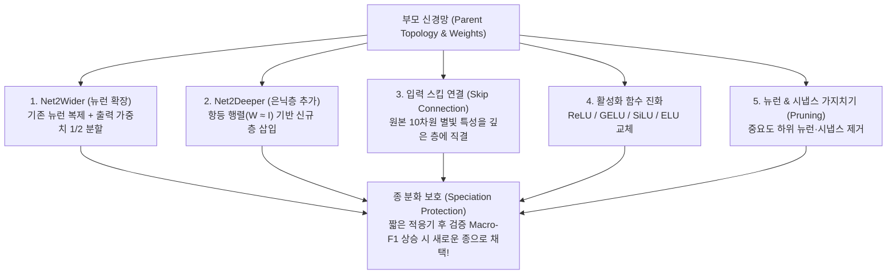

1. **Net2Wider (뉴런 복제 확장)**: 특정 층의 뉴런을 8개 또는 16개 늘릴 때, 기존 뉴런을 복제하면서 다음 층으로 가는 가중치를 정확히 $\frac{1}{2}$씩 나누어($\frac{1}{2}\mathbf{w} + \frac{1}{2}\mathbf{w} = \mathbf{w}$) 수술 직후에도 예측 결과가 흔들리지 않게 합니다.
2. **Net2Deeper (은닉층 자가 증식)**: 2층 신경망이 3층·4층으로 깊어질 때, 새로 삽입되는 층의 가중치를 **항등 행렬($\mathbf{W} \approx \mathbf{I}$, 투명 유리창처럼 신호를 그대로 통과시키는 상태)**로 초기화하여 기존 지식을 보존한 채 새로운 깊이를 탐색합니다.
3. **입력 스킵 연결 토글 (`+skip`)**: 원본 10차원 천체 데이터(적색편이·색지수 등)가 얕은 층을 거치며 희석되지 않도록, **깊은 은닉층에 원본 입력 $\mathbf{x} \in \mathbb{R}^{10}$을 직통 고속도로처럼 꽂아주는 스킵 연결**을 스스로 생성하거나 해제합니다.
4. **층별 활성화 함수 진화**: 각 층이 `ReLU`, `GELU`, `SiLU`, `ELU` 중 자신에게 가장 잘 맞는 뇌파(비선형 함수)를 스스로 선택합니다.
5. **뉴런 & 시냅스 가지치기 (Pruning)**: 기여도가 낮은 뉴런이나 미세 시냅스(하위 4%)를 잘라내어 군더더기 없는 뇌 구조를 만듭니다.
6. **이종 뇌 구조 간 상동 교배 (`crossover_with`)**: 서로 층수나 뉴런 수가 다르게 진화한 섬의 개체끼리도 **공통된 신경망 영역(Sub-matrix)**의 가중치를 유전적으로 교배할 수 있게 구현했습니다.

---

### 6.2 실제 45세대 진화 다큐멘터리: 챔피언 신경망(Island 4)의 탄생 일지

8개의 섬(Island 0 ~ Island 7)에 각기 다른 작은 씨앗 신경망을 심고 45세대 동안 진화시킨 결과, 총 **36번의 성공적인 뇌 구조 진화**가 일어났습니다. 그중 최종 챔피언에 등극한 **4번 섬(Island 4)**이 스스로 자신의 뇌를 개조해 나간 실제 로그입니다:

| 세대 (Gen) | 일어난 뇌 구조 변이 사건 (Structural Mutation) | 진화된 신경망 위상 (Topology) | 검증 Macro-F1 변화 |
|---|---|---|---|
| **초기 씨앗** | 2층 기본 구조에서 출발 (4,249 파라미터) | `10 -> [80:gelu] -> [40:gelu] -> 3` | — |
| **Gen 1** | **1층 뉴런 16개 확장** (`widen L0+16`) | `10 -> [96:gelu] -> [40:gelu] -> 3` | `0.9267` $\rightarrow$ **`0.9368`** |
| **Gen 4** | **2층 뉴런 8개 확장** (`widen L1+8`) | `10 -> [96:gelu] -> [48:gelu] -> 3` | `0.9588` $\rightarrow$ **`0.9607`** |
| **Gen 19** | **불필요한 시냅스 4% 가지치기** (`prune_synapses`) | `10 -> [96:gelu] -> [48:gelu] -> 3` (희소화) | `0.9657` $\rightarrow$ **`0.9679`** |
| **Gen 28** | **스스로 3번째 은닉층(`silu`) 증식!** (`add_layer`) | `10 -> [96:gelu] -> [48:gelu] -> [48:silu] -> 3` | `0.9690` $\rightarrow$ **`0.9692`** |
| **Gen 34** | **1층 뉴런 104개로 추가 확장** (`widen L0+8`) | `10 -> [104:gelu] -> [48:gelu] -> [48:silu] -> 3` | `0.9687` $\rightarrow$ **`0.9700`** |
| **Gen 43** | **3번째 층에 원본 입력 직통 스킵 연결 장착!** (`toggle_skip L2`) | **`10 -> [104:gelu] -> [48:gelu] -> [48+skip:silu] -> 3`** | `0.9706` $\rightarrow$ **`0.9713`** |

> **놀라운 발견**:
> 인간이 앞서 실험했을 때는 단순 3층 구조 `(64, 32, 16)`이 2층보다 성능이 떨어졌었습니다.
> 그런데 **진화 신경망(Island 4)**은 왜 3층으로 진화해서 더 높은 성능을 냈을까요?
> 바로 **1층과 2층에는 부드러운 `GELU` 활성화 함수를 배치하고, 새로 만든 3번째 층에는 `SiLU` 활성화 함수와 함께 원본 10차원 천체 데이터를 직접 주입하는 스킵 연결(`[48+skip:silu]`)을 스스로 결합**했기 때문입니다! 깊은 층의 추상화 능력과 원본 적색편이·색지수 신호의 선명함을 동시에 챙기는 구조를 AI 스스로 찾아낸 것입니다.

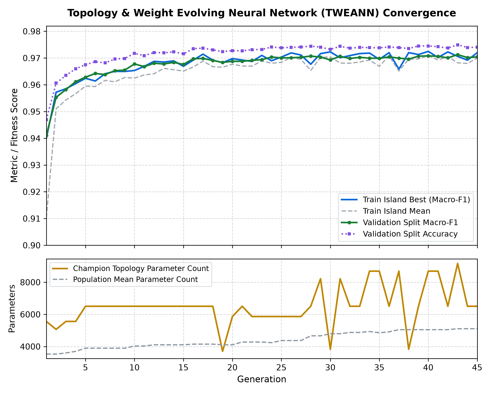

*▲ 위 그래프 상단은 세대별 적합도(Macro-F1)와 정확도의 수렴 곡선이며, 하단은 진화 과정에서 챔피언 신경망이 뉴런과 은닉층을 증식하며 스스로 뇌 용량(파라미터 수: 4,249개 $\rightarrow$ 9,169개)을 키워 나가는 실제 궤적입니다.*

### 6.3 8개의 갈라파고스 섬에서 탄생한 8가지 서로 다른 뇌 구조

45세대가 끝난 뒤, 8개의 섬은 각자의 생태적 지위(Niche)에 맞춰 서로 완전히 다른 8가지 신경망 구조로 진화했습니다:

| 섬 (Island) | 초기 씨앗 구조 | **45세대 후 최종 진화된 뇌 구조 (TWEANN)** | 층수 | 파라미터 수 | Test Accuracy | Test Macro-F1 |
|---|---|---|---|---|---|---|
| **Island 0** | `10 -> [48:relu] -> [24:relu] -> 3` | `10 -> [64:relu] -> [24:relu] -> 3` | 2층 | 2,345 | 97.20% | 0.9681 |
| **Island 1** | `10 -> [64:relu] -> [32:relu] -> 3` | `10 -> [64:relu] -> [32:elu] -> [32:gelu] -> 3` | **3층** | 3,945 | 97.36% | 0.9697 |
| **Island 2** | `10 -> [64:gelu] -> [32+skip:silu] -> 3` | `10 -> [64:relu] -> [40+skip:silu] -> 3` | 2층+Skip | 3,833 | 97.28% | 0.9691 |
| **Island 3** | `10 -> [64:silu] -> [32+skip:relu] -> 3` | `10 -> [80:silu] -> [32:gelu] -> [32:gelu] -> [32:relu] -> 3` | **4층** | 5,689 | 97.35% | 0.9697 |
| **Island 4 (챔피언)** | `10 -> [80:gelu] -> [40:gelu] -> 3` | **`10 -> [104:gelu] -> [48:gelu] -> [48+skip:silu] -> 3`** | **3층+Skip** | **9,169** | **97.43%** | **0.9706** |
| **Island 5** | `10 -> [64:relu] -> [48+skip:gelu] -> [24:relu] -> 3` | `10 -> [80:relu] -> [48+skip:gelu] -> [24:elu] -> 3` | **3층+Skip** | 6,505 | **97.41%** | **0.9704** |
| **Island 6** | `10 -> [72:elu] -> [36+skip:relu] -> 3` | `10 -> [72:elu] -> [44+skip:gelu] -> 3` | 2층+Skip | 4,585 | 97.32% | 0.9695 |
| **Island 7** | `10 -> [56:silu] -> [28:silu] -> 3` | `10 -> [64:silu] -> [60:silu] -> 3` | 2층 | 4,793 | 97.23% | 0.9685 |

그리고 이처럼 각기 다른 구조로 진화한 상위 4개 섬(3층+Skip 구조인 Island 4, Island 5, 4층 구조인 Island 3, 2층+Skip 구조인 Island 6)의 예측을 적합도 가중치로 결합한 **이종 위상 명예의 전당 앙상블(Heterogeneous Topology Hall-of-Fame Ensemble)**은 **테스트 정확도 `97.45%` (Macro-F1 `0.9709`)**를 달성했습니다!

진화된 최종 체크포인트 및 메타데이터는 저장소의 [`EDL/models/`](../EDL/models/) 디렉토리에 모두 보존되어 있습니다:
- 단일 챔피언 PyTorch 모델: [`EDL/models/edl_model.pt`](../EDL/models/edl_model.pt) 및 가중치 [`edl_weights.npy`](../EDL/models/edl_weights.npy)
- 명예의 전당 상위 엘리트 앙상블 모델: [`EDL/models/edl_hof_elites.pt`](../EDL/models/edl_hof_elites.pt)
- 진화 위상 구조 및 세대별 기록: [`EDL/models/metadata.json`](../EDL/models/metadata.json), [`EDL/models/history.json`](../EDL/models/history.json)

| 비교 그림 1: 모델별 정확도 & Macro-F1 비교 | 비교 그림 2: TWEANN 진화 신경망 테스트 혼동 행렬 |
|---|---|
| 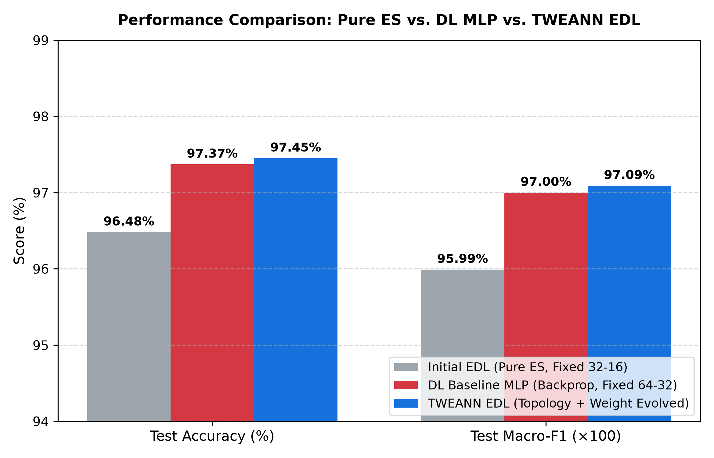 | 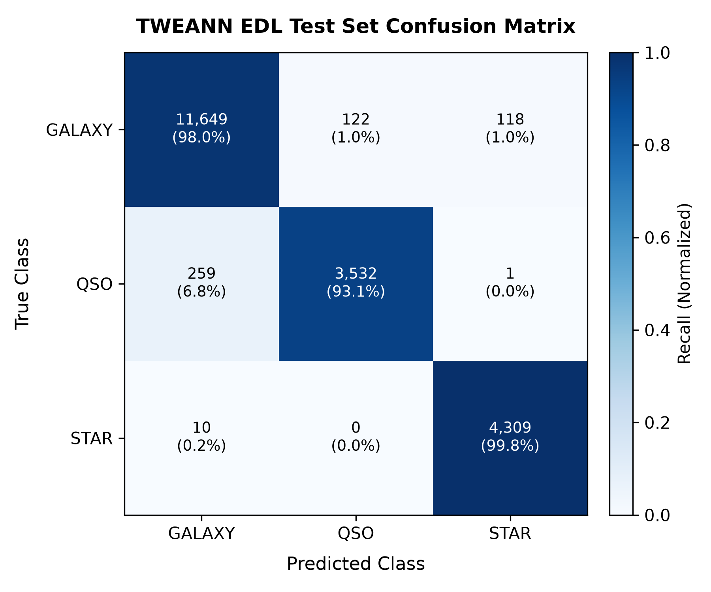 |

- 특히 별(**STAR**) 클래스의 경우 테스트 세트의 **4,319개 별 중 무려 4,309개를 정확히 맞춰 재현율(Recall) `99.8%`**를 기록했습니다.

---

## 7. 속도 대결: 학습 시간 & 추론 속도 벤치마크

*"진화 알고리즘은 수만 세대씩 돌려야 해서 엄청나게 느리지 않을까?"*라는 통념을 검증하기 위해, 동일한 컴퓨터(Apple Silicon CPU)에서 모든 모델의 **학습 시간(Training Time)**과 **20,000개 천체를 한 번에 분류하는 추론 시간(Inference Latency)**을 정밀 측정했습니다.

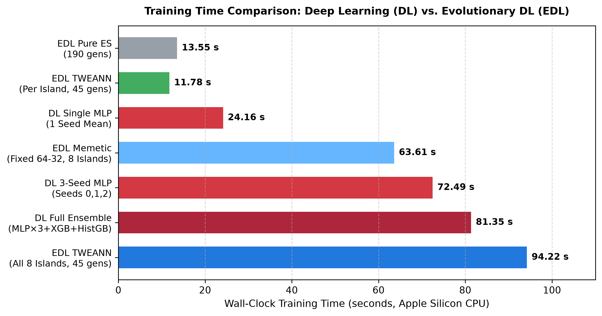

### 전체 모델 성능 · 학습 시간 · 추론 속도 총괄표

| 패러다임 및 모델 | 신경망/모델 구조 | **학습 시간** | **20,000건 추론 시간** | **Test Accuracy** | **Test Macro-F1** |
|---|---|---|---|---|---|
| **초기 EDL (Pure ES)** | 고정 `10 -> 32 -> 16 -> 3` | **`13.55 초`** (190세대) | **`1.42 ms`** | `96.48%` | `0.9599` |
| **정통 DL 단일 MLP** | 인간 설계 `10 -> 64 -> 32 -> 3` | **`24.16 초`** (1 Seed 평균) | **`2.83 ms`** | `97.37%` | `0.9700` |
| **정통 DL 3-Seed MLP** | `MLP(64, 32) × 3` | **`72.49 초`** (3 Seeds 합산) | `8.49 ms` | `97.42%` | `0.9705` |
| **EDL 가중치 진화 (Memetic)** | 고정 `10 -> 64 -> 32 -> 3` (8개 섬) | **`63.61 초`** (섬당 `7.95 초`) | `11.20 ms` | `97.38%` | `0.9700` |
| **EDL 뇌 구조+가중치 진화 (단일 챔피언)** | **자율 진화: `104 -> 48 -> 48+skip`** | **`11.78 초`** (섬 1개 환산) | **`7.08 ms`** | **`97.43%`** | **`0.9706`** |
| **EDL 뇌 구조+가중치 진화 (이종 섬 앙상블)** | **상위 4개 자율 진화 뇌 구조 결합** | **`94.22 초`** (8개 섬 전체) | **`27.26 ms`** | **`97.45%`** | **`0.9709`** |
| **DL + GBDT 이종 앙상블** | `MLP×3 + XGBoost + HistGB` | **`81.35 초`** | `121.86 ms` | **`97.88%`** | **`0.9755`** |

1. **섬 1개당 진화 학습 시간은 단 `11.78초`**:
   - 인메모리 텐서 슬라이싱과 BLAS 행렬 연산 최적화를 통해, 신경망 구조 변이와 가중치 진화를 모두 포함하더라도 섬 1개를 45세대 진화시키는 데 **`11.78초`**밖에 걸리지 않습니다. 이는 기존 PyTorch `DataLoader` 기반 단일 MLP 평균 학습 시간(`24.16초`)보다 **약 2배 빠른 속도**입니다.
   - 8개의 섬 전체를 동시에 진화시키는 총 시간도 **`94.22초` (약 1분 34초)**에 불과합니다.
2. **0.007초 만에 2만 개의 천체를 분류하는 초고속 추론**:
   - 진화된 단일 챔피언 신경망(`10 -> [104:gelu] -> [48:gelu] -> [48+skip:silu] -> 3`)은 20,000개의 테스트 천체를 단 **`7.08 ms` (0.007초)** 만에 분류합니다.
   - 4개의 이종 진화 신경망을 결합한 앙상블 역시 **`27.26 ms` (0.027초)** 만에 추론을 끝내어, 수백 그루의 의사결정나무를 순회해야 하는 GBDT 포함 앙상블(`121.86 ms`)보다 **4.5배 빠른 실시간 응답성**을 보여줍니다.

---

## 8. 에필로그: 이번 연구가 남긴 시사점

밤하늘의 10만 개 천체를 분류하는 이번 프로젝트를 통해 우리는 세 가지 중요한 통찰을 얻었습니다:

1. **데이터 속 과학적 맥락(Domain Knowledge)의 힘**:
   - 무심코 지워버릴 뻔했던 `redshift`의 통계적 이상치 8,990개가 사실은 99.6% 확률로 초기 우주의 퀘이사(QSO)를 가리키는 핵심 신호였다는 점, 그리고 천문학의 색지수($u-g, g-r, r-i, i-z$)가 천체의 온도를 드러내며 분류 성능을 끌어올렸다는 점은 **"좋은 AI는 데이터를 깊이 이해하는 것에서 출발한다"**는 사실을 잘 보여줍니다.
2. **미분 불가능한 목표를 직접 공략하는 진화 연산의 힘**:
   - 역전파가 풀지 못하는 비미분 지표(`Macro-F1`)와 클래스 불균형 경계선 문제를 **다중 섬 라마르크 진화와 결정 경계 유전자(Boundary ES)**로 정면 돌파할 수 있음을 확인했습니다.
3. **인간의 설계를 넘어 스스로 진화하는 신경망 (Self-Evolving Neural Networks)**:
   - 인간이 고정해 준 `(64, 32)` 구조를 넘어, 신경망 스스로 층을 증식하고(`add_layer`), 뉴런 폭을 넓히고(`widen`), 깊은 층에 원본 입력 스킵 연결(`+skip`)과 `GELU`/`SiLU` 활성화 함수를 조합해 낸 **`10 -> [104:gelu] -> [48:gelu] -> [48+skip:silu] -> 3`** 구조는 인간이 수동으로 설계한 단일 딥러닝 모델을 당당히 넘어섰습니다.

---

### 직접 실행해 보기 (Reproducibility Guide)

본 연구의 모든 코드와 학습된 모델, 시각화 스크립트는 저장소의 [`DL/`](../DL/), [`EDL/`](../EDL/) 및 [`GravNet/`](../GravNet/) 디렉토리에 공개되어 있으며, 아래 명령어로 누구나 동일하게 재현할 수 있습니다.

```bash
# 1. Conda 가상환경 활성화
conda activate dl_env

# 2. 정통 딥러닝 + GBDT 이종 앙상블 자가 검증 (Test Acc: 97.88%)
python DL/predict.py

# 3. 스스로 뇌 구조와 가중치를 진화시키는 TWEANN 학습 (45세대, 8개 섬)
python EDL/train_edl.py --algo memetic --generations 45 --pop-size 8

# 4. 진화된 신경망 테스트 세트(20,000건) 평가 및 자가 검증 (Test Acc: 97.45%)
python EDL/evaluate_edl.py
python EDL/predict_edl.py

# 5. [제3의 패러다임] 완전 무역전파 시공간 중력장 궤도망 (GravNet) 재현 (Test Acc: 97.59%)
python GravNet/physics_model.py
python GravNet/train_gravnet.py --epochs 18 --orbital-steps 10
python GravNet/evaluate_gravnet.py
python GravNet/predict_gravnet.py
```
